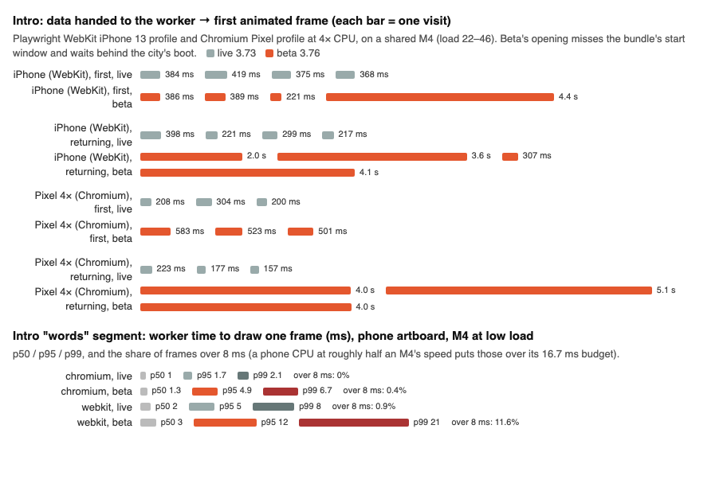

# Beta 3.76 β: what stutters, and why (QA, 19–20 October 2026)

Daniel tested beta.cromaticstudios.com (beta 3.76 β) and said that everything stutters badly ("totul sacadează grav"). This report measures beta against live cromaticstudios.com (beta 3.73) and finds what stutters, where, on which engine, and why. Nothing was fixed here.

- **Beta** is live 3.73 plus three changes: the Nine cups v2 opening (3.74), the Lottie pill transitions (3.75) and the Sketchbook notebook (3.76).
- **Source** is the `stack-374` branch, head `d32405d`. All `file:line` references below are to that commit.
- **Live** is `origin/main` `7e840f4` without `beta/nav2.patch`.

## The short answer

The map itself does not stutter more in beta. When the machine was quiet, beta and live ran the same, at 58–60 fps on the laptop and the iPhone profile. That covered:

- the map at rest;
- driving with drift, in Street view and Bird's eye;
- place cards, the boarding pass, the mini-game, the website and the Night world.

The worse numbers for beta in the busy runs follow the machine's load, not the code (see "Reading the numbers").

What is new and measurably worse is concentrated in the first seconds of every visit and in the case-page transitions:

1. **The opening (Nine cups v2) costs 1.5–3 times as much to draw per frame, in the Lottie worker.**
   - In the full page on an idle M4, the worker spends 1.5–2× live's time per frame (Chromium: 2.5 against 1.7 ms, and 2.2 against 1.1 ms on the Pixel profile). Every frame still fits in 16.7 ms there.
   - Over the cups' spin alone, isolated, its p95 goes from 1.7 to 4.9 ms in Chromium and from 5 to 12 ms in WebKit.
   - On a busy M4, the nearest stand-in here for a phone's slower CPU, beta's opening went over the 16.7 ms budget 39–53 times per visit in WebKit, against 5–25 for live.
   - So on a phone the cups' spin is where the opening drops frames. **New in beta.**
2. **The opening's data is 4.3 times larger (2.3 MB, 130 KB brotli), so the opening starts late.** It often loses the race with the city's boot on a busy CPU, and then the first line or the pill stands still for 2–5 s.
   - Measured: WebKit 4 of 8 visits, Pixel 4× returning visits 3 of 3, and once on the laptop at low load ("back to map", 1.5 s).
   - Live: never more than 0.53 s without network throttling.
   - On a slow 4G connection, the first animated frame comes 1.0–4.5 s later than on live.
   - A returning visitor downloads and parses the whole 2.3 MB for a 0.45 s pill.

   **New in beta.**
3. **A busy main thread stops the Lottie animations between segments.** Every segment hand-off goes worker → main thread → worker.
   - The returning visitor's pill freezes while the city boots: 1.6–3.1 s on live, another 4.2–4.5 s on beta after its late start (Pixel 4×).
   - In Safari, the pill window freezes for up to 0.5 s between its two halves while the case page parses.

   **The mechanism is old; beta adds more animation that depends on it.**
4. **The pill transitions on Safari (WebKit).**
   - The window drops frames: in the worst transition it drew 30 of its 58 frames.
   - The map freezes the moment "Go deeper" is tapped: it stops rendering under the paper.
   - The first opening waits 0.35–0.5 s for the window to mount.
   - Closing a page takes about 0.6 s, against 0.15 s on live.

   Chromium (laptop, Pixel at 4×) draws all 58–60 frames. **New in beta.**
5. **Sketchbook is not a cause.**
   - The notebook is about 2.5 times cheaper per frame than live's graphite Sketchbook (laptop 9.8 / 11.0 ms against 26.7 / 26.4 ms; Pixel 4× Street view driving 43 against 19 fps, median of 4).
   - Only the first switch into it costs more: about 0.1–0.25 s more of main-thread work, plus two web fonts.

**What I could not reproduce:** a constant stutter while driving. On an M4 the map is the same in beta and live. If Daniel saw it on his phone while driving the plain city, after the opening had ended, the next step is a trace from the device (see "Confirming on Daniel's iPhone").

## Setup and method

- **Machine:** Apple M4, 10 cores, 16 GB, shared with other agents the whole time.
  - 1-minute load average from 7 to 104.
  - Memory nearly full: about 60 MB of free pages; a runaway Sublime Text `crash_handler` used 1.5–2.4 cores throughout.
  - `uptime` was recorded on every segment of every run (the "load" column).
- **Engines:**
  - **Laptop:** Chromium 1440×900 @2x on the real GPU (`--use-angle=metal --enable-gpu --ignore-gpu-blocklist`).
  - **Pixel:** Chromium 412×915 @2.625, touch, Pixel 7 user agent, CPU at 4× (`Emulation.setCPUThrottlingRate`). The 4× slows down the main thread only, not the Lottie worker.
  - **iPhone:** Playwright WebKit with the iPhone 13 profile. It runs on the M4's CPU and GPU, so it shows WebKit's behaviour, not an A15's speed.
  - Everything ran headless.
- **What was measured:**
  - **Main thread:** the intervals between `requestAnimationFrame` calls (fps, p95, p99, frames over 50 ms), and long tasks in Chromium.
  - **The Lottie worker:** its own `requestAnimationFrame` calls (pacing) and the time each frame takes to draw. The probe was injected into the worker through Playwright.
  - **Attribution:** Chromium traces (thread time, long tasks, CPU profile), `__perfLab.bench()`, and isolated micro-benchmarks repeated 5–7 times in alternation (beta, live, live, beta).
  - **WebKit check:** a worker's OffscreenCanvas keeps updating while the main thread is blocked. Verified with a test page: the worker's bar kept moving through 600 ms blocks while a DOM bar on the main thread stood still. So in Safari the opening's smoothness is the worker's own, as in Chrome.
- **Scenarios:** run on each engine, for beta and for live. The live/beta order alternated, and there were 4 runs per cell; the tables show medians.
  1. A first visit (fresh context).
  2. A returning visit.
  3. The map at rest for 10 s.
  4. Driving 30 s (arrows, a drift every third turn) in Street view and in Bird's eye.
  5. A place card: a tap, then the auto-pilot, then the card. The place nearest the car among those with a case page, via `__mapGo`, the same path as a tap on its pin.
  6. "Go deeper" and closing the page (Escape, then ×).
  7. The mini-game open and closed.
  8. The boarding pass opened and closed, not sent.
  9. The worlds, through the Multiverse menu: Sketchbook (idle, driving Street and Bird's eye), then Night, then Cromatic.
  10. "Normal website" and back to the map.
- **Excluded runs:** five "Go deeper" segments were left out. In four the drive had ended at Olari 9, whose own cards took the click; in one the place opened a modal instead of a case page. All are harness problems, not the site's.

### Reading the numbers

**Under load, both versions get worse, beta more often.** The cleanest pairs are the iPhone run 3 and laptop run 4 (load 7–12). In those, beta and live are within noise of each other everywhere after the opening:

| Low-load pair (load 7–12) | Map at rest | Street drive | Bird's eye drive | Case page open | Sketchbook Street | Sketchbook Bird's eye |
|---|---|---|---|---|---|---|
| Laptop, live / beta (fps) | 59.7 / 59.4 | 56.6 / 58.7 | 60.0 / 59.7 | 59.7 / 58.4 | 59.4 / 59.8 | 59.4 / 60.0 |
| iPhone WebKit, live / beta (fps) | 58.5 / 58.2 | 58.6 / 59.7 | 59.8 / 59.9 | 57.4 / 58.2 | 58.6 / 59.5 | 57.2 / 59.0 |

**A measurement artefact, the same on both:** the first key pressed on the map builds the sound (`new AudioContext()`, `src/nav2.js:1537`). On this Mac that blocked the main thread for between 1.6 s and 19.5 s in the traces, because the audio service was slow.

- It lands in the first driving segment (its "max"), or in Escape when no key was pressed before.
- It is in both versions.
- See cause 6.

## Results: scenarios × engine × live / beta

These are medians over the runs. "load" is the median 1-minute load average while the segment ran. Cells where beta and live ran at very different loads should be read through the low-load table above.

#### Laptop: Chromium 1440×900 @2x, real GPU

| Scenario | fps live / beta | p95 ms live / beta | p99 ms live / beta | frames > 50 ms live / beta | load live / beta |
|---|---|---|---|---|---|
| first visit: intro to map | 41 / 46.1 | 25.7 / 25.9 | 117 / 84.1 | 10.5 / 12 | 21.8 / 24.3 |
| returning visit: pill to map | 32.8 / 29.5 | 35.3 / 50.5 | 318 / 750 | 8.5 / 11 | 21.1 / 25.3 |
| map idle 10 s | 58.6 / 49.8 | 18.6 / 34.3 | 33.7 / 66 | 1.5 / 7 | 20.9 / 28 |
| drive Street 30 s (arrows + drift) | 54.6 / 53.3 | 25.4 / 26.4 | 34 / 40.8 | 6 / 9.5 | 20.9 / 24.8 |
| drive Bird's eye 30 s (arrows + drift) | 56.5 / 55.7 | 25.9 / 26.3 | 34.3 / 35.2 | 8 / 14.5 | 18.1 / 25 |
| place card: tap a place → auto-pilot → card +4 s | 59.4 / 54.5 | 18 / 33.5 | 33.1 / 35.3 | 0 / 0.5 | 20.5 / 24.8 |
| Go deeper: case page opens +3 s | 59.3 / 55.9 | 18.1 / 25.9 | 26.5 / 41.5 | 0.5 / 1.5 | 13.9 / 23.3 |
| case page closes (Escape) +2.5 s | 59.3 / 53.4 | 18.4 / 33.5 | 34 / 41.7 | 0 / 1 | 16.8 / 23.3 |
| Go deeper again +3 s | 60 / 55.7 | 18 / 32.6 | 18.2 / 34.8 | 0 / 1 | 12.8 / 23.5 |
| case page closes (x) +2.5 s | 59 / 59.1 | 18 / 18.6 | 26.5 / 26.6 | 0 / 0 | 12.8 / 23.5 |
| Normal website: map side, click to unload | 60 / 52 | 18.1 / 35 | 18.1 / 35 | 0 / 0 | 29.1 / 20.2 |
| website page: load +3 s (arrival) | 58.8 / 58.5 | 18.1 / 18.6 | 33.8 / 33.9 | 0.5 / 0.5 | 27.8 / 21.9 |
| back to map: load to map | 25.3 / 31.9 | 42.3 / 34.8 | 1399 / 557 | 9 / 12 | 26.6 / 21.7 |
| mini-game opens +5 s | 58.3 / 58.5 | 18.4 / 18.6 | 34 / 26.5 | 1 / 2 | 15.9 / 25.2 |
| mini-game closes +2.5 s | 58.8 / 57.7 | 18.1 / 18.6 | 33.3 / 34 | 0.5 / 0.5 | 15.9 / 25.2 |
| boarding pass opens +3 s | 57.5 / 59.7 | 18.1 / 18.6 | 42.6 / 18.7 | 1.5 / 0 | 16.6 / 24 |
| boarding pass closes +2 s | 51.9 / 56.6 | 26.2 / 25.9 | 75 / 27 | 3 / 0.5 | 22.8 / 24 |
| Multiverse → Sketchbook +4 s | 31.6 / 44.9 | 67.7 / 49.6 | 241 / 124 | 14.5 / 12 | 23.7 / 24.3 |
| Sketchbook idle 6 s | 48.6 / 59.8 | 34.3 / 18.6 | 34.9 / 18.8 | 3 / 0 | 32.9 / 23.2 |
| Sketchbook drive Street 20 s | 47 / 58.5 | 34.6 / 18.6 | 58.6 / 26.4 | 30 / 0.5 | 32.1 / 20.5 |
| Sketchbook drive Bird's eye 20 s | 45.3 / 52.7 | 34.7 / 26.9 | 66.3 / 42.9 | 42.5 / 12.5 | 31.7 / 21.2 |
| Multiverse → Night +4 s | 57.5 / 45.9 | 25.3 / 34.7 | 27 / 76 | 0.5 / 4 | 31.4 / 20.5 |
| Night drive Bird's eye 10 s | 55.9 / 54.7 | 26 / 26.3 | 34.5 / 49.5 | 5 / 7 | 31.2 / 19.5 |
| Multiverse → Cromatic +4 s | 57.5 / 55.3 | 18.6 / 25.3 | 26.1 / 34.4 | 1 / 2 | 29.1 / 20.2 |

#### Pixel-like phone: Chromium 412×915 @2.625, CPU 4×

| Scenario | fps live / beta | p95 ms live / beta | p99 ms live / beta | frames > 50 ms live / beta | load live / beta |
|---|---|---|---|---|---|
| first visit: intro to map | 18.9 / 29 | 107 / 50.9 | 1209 / 175 | 21 / 22.5 | 22.5 / 21.8 |
| returning visit: pill to map | 12.7 / 16.7 | 142 / 116 | 2366 / 1100 | 22.5 / 20 | 21.3 / 20.6 |
| map idle 10 s | 32.6 / 40.2 | 57.6 / 35.2 | 91.9 / 74.3 | 29 / 8 | 24.2 / 19.4 |
| drive Street 30 s (arrows + drift) | 32.6 / 31.6 | 58.8 / 52.3 | 83.2 / 83.7 | 120 / 114 | 21.3 / 23.2 |
| drive Bird's eye 30 s (arrows + drift) | 31.8 / 34.7 | 51 / 50 | 75.8 / 74.1 | 97 / 63 | 20.9 / 24 |
| place card: tap a place → auto-pilot → card +4 s | 33.9 / 36 | 49.7 / 51 | 82 / 75.9 | 16 / 28 | 19.7 / 27 |
| Go deeper: case page opens +3 s | 40.4 / 52.8 | 66.1 / 26.8 | 142 / 100 | 8.5 / 3.5 | 20.2 / 10.8 |
| case page closes (Escape) +2.5 s | 33.2 / 37.8 | 49.2 / 42.8 | 75.7 / 74.2 | 3.5 / 4.5 | 20.2 / 26.5 |
| Go deeper again +3 s | 48 / 56.1 | 41.3 / 25.4 | 108 / 42 | 6.5 / 2 | 27.5 / 11.7 |
| case page closes (x) +2.5 s | 35.3 / 46.9 | 51 / 34.3 | 108 / 48.1 | 6.5 / 1 | 32.2 / 14.9 |
| Normal website: map side, click to unload | 46.1 / 31.5 | 34.2 / 41.7 | 34.2 / 41.7 | 0 / 0 | 21 / 30.2 |
| website page: load +3 s (arrival) | 54.4 / 54.2 | 18.6 / 18.6 | 67.8 / 108 | 2 / 2 | 20.3 / 28.7 |
| back to map: load to map | 18.6 / 9.8 | 99.6 / 216 | 1349 / 2684 | 24.5 / 27 | 22.5 / 25.3 |
| mini-game opens +5 s | 47.5 / 50.7 | 41.6 / 34.1 | 91.8 / 66.3 | 7 / 5.5 | 30.4 / 22.8 |
| mini-game closes +2.5 s | 36.9 / 42.1 | 42.8 / 42.6 | 92.7 / 59.2 | 4.5 / 4.5 | 29.6 / 22.3 |
| boarding pass opens +3 s | 48.5 / 44.7 | 34 / 34.3 | 49.8 / 66.5 | 1.5 / 3 | 28.6 / 21.3 |
| boarding pass closes +2 s | 25.6 / 30.9 | 108 / 59.8 | 191 / 125 | 8.5 / 6.5 | 27.2 / 21.3 |
| Multiverse → Sketchbook +4 s | 5.3 / 7.7 | 1159 / 1126 | 1600 / 1558 | 10 / 9.5 | 26.2 / 20.7 |
| Sketchbook idle 6 s | 22.8 / 41.8 | 67.9 / 41.9 | 83.8 / 50.4 | 45.5 / 2.5 | 25.8 / 20.1 |
| Sketchbook drive Street 20 s | 18.6 / 43.4 | 92.3 / 42.3 | 125 / 58.1 | 219 / 30 | 23.8 / 28.9 |
| Sketchbook drive Bird's eye 20 s | 20.2 / 32.8 | 83.1 / 51.4 | 108 / 76.3 | 187 / 92 | 25.2 / 33.9 |
| Multiverse → Night +4 s | 22.7 / 19.9 | 84.4 / 92.7 | 176 / 242 | 28 / 39.5 | 24.4 / 34.2 |
| Night drive Bird's eye 10 s | 31.1 / 27.6 | 51.1 / 66.9 | 90.7 / 108 | 56.5 / 66 | 21.9 / 31.7 |
| Multiverse → Cromatic +4 s | 34.2 / 35.8 | 42.5 / 43 | 84.6 / 117 | 8.5 / 9 | 21 / 30.2 |

#### iPhone 13 profile: WebKit

| Scenario | fps live / beta | p95 ms live / beta | p99 ms live / beta | frames > 50 ms live / beta | load live / beta |
|---|---|---|---|---|---|
| first visit: intro to map | 30.3 / 36.5 | 37.5 / 33 | 761 / 115 | 12.5 / 18 | 19.1 / 21.4 |
| returning visit: pill to map | 31.2 / 27.5 | 40 / 45 | 818 / 716 | 6.5 / 10 | 17.6 / 20.4 |
| map idle 10 s | 57.3 / 51.3 | 22 / 35 | 43 / 72.5 | 3.5 / 12.5 | 16.1 / 17.5 |
| drive Street 30 s (arrows + drift) | 50.4 / 43.2 | 36.5 / 67 | 63 / 190 | 35.5 / 64.5 | 16.6 / 21.5 |
| drive Bird's eye 30 s (arrows + drift) | 54.4 / 46.3 | 26.5 / 50.5 | 50.5 / 86 | 17 / 56.5 | 15.6 / 17.4 |
| place card: tap a place → auto-pilot → card +4 s | 46.3 / 58.1 | 46.5 / 23 | 66 / 31 | 14 / 1.5 | 16.1 / 16.1 |
| Go deeper: case page opens +3 s | 50.5 / 53.2 | 25 / 27 | 110 / 85 | 4 / 5.5 | 16 / 16 |
| case page closes (Escape) +2.5 s | 48.5 / 57.5 | 33.5 / 23.5 | 71.5 / 38 | 3 / 0.5 | 19.4 / 15.4 |
| Go deeper again +3 s | 52 / 56.2 | 24.5 / 21 | 117 / 59.5 | 4 / 2.5 | 18.6 / 14.8 |
| case page closes (x) +2.5 s | 57.8 / 59 | 22 / 20.5 | 38 / 24 | 1.5 / 0.5 | 18.4 / 14.7 |
| Normal website: map side, click to unload | 40 / 31.4 | 25 / 124 | 25 / 124 | 0 / 1.5 | 17.2 / 15.4 |
| website page: load +3 s (arrival) | 57.5 / 41 | 21.5 / 59.5 | 48 / 350 | 1 / 9 | 17.2 / 16.3 |
| back to map: load to map | 18.6 / 19.5 | 214 / 1906 | 1138 / 7626 | 20 / 7.5 | 18.1 / 23.8 |
| mini-game opens +5 s | 31.3 / 45.1 | 61 / 45.5 | 141 / 71 | 36.5 / 12 | 17.2 / 14.1 |
| mini-game closes +2.5 s | 57.8 / 58.5 | 21 / 19.5 | 37.5 / 43 | 1 / 1 | 17.2 / 14.1 |
| boarding pass opens +3 s | 54.6 / 55.3 | 26 / 26 | 46.5 / 40 | 2.5 / 1 | 16.5 / 14 |
| boarding pass closes +2 s | 43.4 / 46.3 | 50 / 43 | 65 / 62.5 | 3 / 4.5 | 16 / 14 |
| Multiverse → Sketchbook +4 s | 33.3 / 34.3 | 126 / 96.5 | 249 / 253 | 12 / 10 | 15.1 / 14.4 |
| Sketchbook idle 6 s | 55.4 / 51.1 | 25.5 / 33.5 | 29.5 / 68 | 0.5 / 5 | 14.5 / 14 |
| Sketchbook drive Street 20 s | 43 / 38.2 | 48.5 / 89 | 75 / 183 | 43 / 75.5 | 13.1 / 14 |
| Sketchbook drive Bird's eye 20 s | 36.5 / 47.3 | 74.5 / 45 | 130 / 67.5 | 83.5 / 34.5 | 18.3 / 15.3 |
| Multiverse → Night +4 s | 43.7 / 33.6 | 50 / 128 | 104 / 284 | 12 / 16.5 | 17.5 / 15.1 |
| Night drive Bird's eye 10 s | 51.6 / 43.5 | 27 / 52.5 | 33.5 / 79.5 | 1.5 / 28 | 16 / 15.6 |
| Multiverse → Cromatic +4 s | 52 / 46.6 | 28.5 / 37 | 55.5 / 59.5 | 4.5 / 7 | 17.2 / 15.5 |

The medians hide where the load fell:

- **Drives:** beta's iPhone runs 1 and 2 drove at load 27–49, live's at 17–28. In the quiet runs 3 and 4 both drove at 58–60 fps.
- **Back to map:** beta's 15–18 s main-thread stalls came from those same busy runs. In a quiet repeat of map → website → map, beta took 4.6–6.5 s to the map against live's 6.5–9.8 s.

### The Lottie worker (the opening and the pill window)

"draw" is the time to draw one frame inside the worker, in ms. Worker fps counts the pauses between segments too, so a low worker fps with a low p95 means the animation stood still between segments (cause 3), not that it drew slowly. Live has no worker on case pages: its page grows out of the card in CSS.

#### Laptop: Chromium 1440×900 @2x, real GPU

| scenario | live fps | beta fps | live p95 | beta p95 | live >50 | beta >50 | live draw p50/p95 | beta draw p50/p95 |
|---|---|---|---|---|---|---|---|---|
| first visit: intro to map | 59.3 | 59.8 | 18.5 | 18.4 | 1 | 0 | 1.8/6.3 | 2.6/11 |
| returning visit: pill to map | 50.7 | 48.1 | 18.8 | 21.1 | 2 | 4.5 | 2/7.8 | 2.6/12.6 |
| Go deeper: case page opens +3 s | – | 60.3 | – | 20.1 | – | 0 | –/– | 8.2/13.4 |
| case page closes (Escape) +2.5 s | – | 57.7 | – | 20.9 | – | 0.5 | –/– | 7.5/11.4 |
| Go deeper again +3 s | – | 59.7 | – | 19.9 | – | 0 | –/– | 5.1/8.9 |
| case page closes (x) +2.5 s | – | 59.5 | – | 18.7 | – | 0 | –/– | 3.9/6 |
| back to map: load to map | 47.2 | 41.8 | 19.5 | 22.4 | 3 | 3 | 2.2/7.7 | 2.8/17.3 |

#### Pixel-like phone: Chromium 412×915 @2.625, CPU 4×

| scenario | live fps | beta fps | live p95 | beta p95 | live >50 | beta >50 | live draw p50/p95 | beta draw p50/p95 |
|---|---|---|---|---|---|---|---|---|
| first visit: intro to map | 58 | 59.7 | 18.9 | 18.9 | 3.5 | 0.5 | 1.9/5.9 | 2/7.6 |
| returning visit: pill to map | 42.5 | 35.8 | 19.8 | 20.3 | 2.5 | 2 | 2.3/8 | 2/8.5 |
| Go deeper: case page opens +3 s | – | 56.9 | – | 18.5 | – | 0.5 | –/– | 3.3/5.5 |
| case page closes (Escape) +2.5 s | – | 59.5 | – | 18.5 | – | 0 | –/– | 3.5/5.5 |
| Go deeper again +3 s | – | 60.8 | – | 18.6 | – | 0 | –/– | 4/6 |
| case page closes (x) +2.5 s | – | 59.2 | – | 19.3 | – | 0 | –/– | 3.5/6.3 |
| back to map: load to map | 44.3 | 31.9 | 18.8 | 22.3 | 1 | 1.5 | 1.9/7 | 2.5/12.6 |

#### iPhone 13 profile: WebKit

| scenario | live fps | beta fps | live p95 | beta p95 | live >50 | beta >50 | live draw p50/p95 | beta draw p50/p95 |
|---|---|---|---|---|---|---|---|---|
| first visit: intro to map | 51 | 50.7 | 28 | 29.5 | 7 | 11.5 | 4/8.5 | 4/12.5 |
| returning visit: pill to map | 47 | 47 | 20.5 | 27.5 | 1.5 | 3.5 | 3.5/6.5 | 4.5/11 |
| Go deeper: case page opens +3 s | – | 53.5 | – | 25.5 | – | 0 | –/– | 3.5/6 |
| case page closes (Escape) +2.5 s | – | 53.2 | – | 25.5 | – | 0.5 | –/– | 3/6 |
| Go deeper again +3 s | – | 52.5 | – | 24 | – | 0 | –/– | 3/7 |
| case page closes (x) +2.5 s | – | 54.2 | – | 22 | – | 0 | –/– | 3/4 |
| back to map: load to map | 40.1 | 27.6 | 44 | 157 | 18.5 | 13.5 | 4.5/14.5 | 4/25.5 |

## The causes, ranked by impact

### 1. The opening's cups cost 1.5–3 times as much to draw per frame (intro) — new in beta

**What runs:** the Lottie worker, every frame of the opening's "words" segment, which includes the cups' spin.

| | 3.73 (live) | 3.76 (beta) |
|---|---|---|
| Layers active in "words" (with nested ones) | 70 | 349 (70 precomps) |
| Animated path keyframes | 0 | 1,650 |
| Also per cup | | 2 masks on the handles, a keyed mask on the coffee image, keyed gradient fills |

Time to draw one frame of "words" (phone artboard at 780×1688, M4, load ~9, 4 alternating runs):

| | p50 | p95 | p99 | frames over 8 ms | frames over 16.7 ms |
|---|---|---|---|---|---|
| Chromium, live | 1.0 | 1.7 | 2.1 | 0 % | 0 |
| Chromium, beta | 1.3 | 4.9 | 6.7 | 0.4 % | 0 |
| WebKit, live | 2 | 5 | 8 | 0.9 % | 0.14 % |
| WebKit, beta | 3 | 12 | 21 | 11.6 % | 2.1 % |

- **Under load (about 70):** the same test gave WebKit beta p95 20 / p99 46 ms, with 8 % of frames over 16.7 ms, against live 14 / 29 ms and 3.2 %.
- **In the full page** (the matrix's first visits: the worker's own time per frame, averaged over the whole opening):

  | Worker time per frame | live | beta |
  |---|---|---|
  | Laptop, Chromium, idle (load 8–11) | 1.66 ms (p95 4.1) | 2.53 ms (p95 5.4) |
  | Pixel profile, Chromium, idle (load 9–14) | 1.09 ms (p95 3.5) | 2.17 ms (p95 4.8) |
  | iPhone profile, WebKit, idle (load 6–13), 2 runs | 2.2–2.7 ms (p95 4–5) | 2.3–3.7 ms (p95 4–8) |
  | iPhone profile, WebKit, busy (load 26–41), 2 runs | 6.1–7.4 ms; 5 and 25 frames over 16.7 ms | 7.4–8.0 ms; 39 and 53 frames over 16.7 ms |

  The isolated WebKit test drew the spin more slowly than the full page did on an idle M4 (p95 12 ms against 4–8). Either way beta needs more per frame; the gap grows under CPU pressure.
- **Identical frames cost more too:** on "hold" and "short", which are the same 19 layers in both versions, beta's p50 is about 30 % higher. The worker walks the whole 307-layer composition every frame, active or not.
- **CPU profile of the worker:** the time is split between drawing (`CVContextData.stroke`, `fill`, `save` / `restore`, `CVShapeElement.drawLayer`) and keyframe interpolation (`getValueAtCurrentTime`, `interpolateValue`, `prepareProperties`).

**On a phone (an estimate):** an A15 runs at roughly half an M4's speed in a worker. That puts beta's p95 during the spin around 10–25 ms against live's 8–10 ms, so beta's spin crosses the 16.7 ms budget where live's does not.

**Code:**

- The data: `src/intro/intro-phone.json`, `src/intro/intro-desktop.json`, built by `design/intro-lottie/_source/lib/cup2layers.mjs`:
  - the masked handle drawn twice: `:241-251`;
  - the masked coffee image: `:274`;
  - the keyed gradient fills: `:61-71`.
- The player: `src/intro/boot.js:212` (`loadAnimation`); its canvas size: `boot.js:122` (`dpr()`, up to 2× and 3.5 MP).

**Fix (intro), in order of payoff:**

1. Bake the spin as an image sequence: a sprite atlas, for example 24–36 frames per cup design, drawn as image layers. `drawImage` costs far less in lottie's canvas renderer than masked, gradient-filled paths whose vertices are interpolated every frame.
2. If the cups stay vectors:
   - clip the handle in the baker instead of drawing it twice with masks;
   - flatten the gradients into fills or into the atlas;
   - hold every other key during the spin (30 fps keys);
   - split the composition per segment, so "hold", "handoff" and "short" no longer walk the cups' layers.
3. On phones, cap the opening's canvas at 1.5× (`boot.js:122`). That is about 44 % fewer pixels to fill, and the shapes are flat colour.

### 2. The opening's data is 4.3 times larger: a late start and a heavier hand-off (intro) — new in beta

**The data:**

| | 3.73 (live) | 3.76 (beta) |
|---|---|---|
| `intro-*.json` raw | 0.53 MB | 2.3 MB |
| `intro-*.json` brotli | 24 KB | 130 KB |
| Returning visitors | fetch and parse it all | fetch and parse it all, for a 27-frame (0.45 s) pill |

**Main-thread cost when the data is handed to the worker.** The JSON is parsed by `r.json()` at `boot.js:228`, then structured-cloned in lottie's proxy (`postMessage`, `src/intro/vendor/lottie_worker.js:21199-21205`).

Parse + clone, median of 7, in ms:

| | Chromium M4 | Chromium 4× | WebKit M4 |
|---|---|---|---|
| live | 3 + 4 | 11 + 15 | 3 + 10 |
| beta | 12 + 23 | 47–52 + 104–112 | 15 + 43–45 |

An earlier, busier run (load 15–30) gave WebKit 34–48 + 125–192 ms for beta, against 7 + 26–42 ms for live.

**The worker's own preparation:**

- From `loadAnimation` to `DOMLoaded`, the worker deserializes the data and builds 307 layers.
- In isolation, beta takes 2.2–3.3 times longer: Chromium 168–246 ms against 81–112 ms; WebKit 233–456 ms against 104–137 ms.

**The race.** The app's bundle starts as soon as the opening starts, or at the latest 1.2 s into a first visit and 0.6 s into a returning one (`boot.js:193`, `build/build.mjs:236`). The bundle's first tasks are the city's boot: 1 s on a laptop, 3–4 s at 4× CPU. When beta's data is not ready in time:

- the bundle starts first;
- the worker's `DOMLoaded` and the start wait behind the boot;
- the visitor sees the first line of text (first visit) or the pill (returning) standing still for seconds.

Time from data handed to the worker to the first animated frame:

| | first visit, live | first visit, beta | returning, live | returning, beta |
|---|---|---|---|---|
| WebKit iPhone (load 24–37), 4 runs | 368–419 ms | 221, 386, 389 ms, **4.4 s** | 217–398 ms | 307 ms, **2.0 s, 3.6 s, 4.1 s** |
| Pixel 4× (load 21–46), 3 runs | 200–304 ms | 501–583 ms | 157–223 ms | **4.0 s, 4.0 s, 5.1 s** |
| Laptop at load 9 (matrix run 4) | 122 ms | 233 ms | 89 ms (back to map: 115 ms) | 357 ms (back to map: **1.47 s**) |

On a quiet M4 the phone profiles mostly won the race:

- in a map → website → map test, WebKit beta took 181–341 ms against live 98–186 ms;
- in the matrix's quietest runs (load 6–15), beta took 130–323 ms against live 65–526 ms.

A real iPhone is slower than a quiet M4, and on a phone network the download adds to it:

- **Pixel 4× with slow 4G** (1.6 Mbps, 150 ms RTT): beta's JSON arrives at 3.27–3.29 s against 1.84–1.86 s for live.
- **The first animated frame** comes at 4.1 s and 7.6 s on beta, against 3.08–3.09 s on live.

**Fix (intro):**

1. Do not parse or clone the opening on the main thread.
   - Hand the worker the response text, or better its `ArrayBuffer` as a transferable, and `JSON.parse` it there. This is a small patch to lottie's proxy (`lottie_worker.js:20945-20973` and `:21199`) and to the worker's `load` handler (`:20649`).
   - Or let the worker fetch the URL itself: lottie's own `path` option fetches on the main thread, so it needs the same patch.
2. Split the file.
   - Put the pill-only composition ("short", "hold", "handoff": 19 layers, the same as 3.73's) in its own small JSON. It is what returning visitors and reduced motion need.
   - Fetch the cups' "words" separately, only for a first visit.
3. Make the bundle wait for the opening's first frame (`DOMLoaded`, then one `enterFrame`), not a fixed 0.6 s / 1.2 s.
   - Keep a longer safety cap, for example 2.5 s, so a dead worker cannot hold the map.
   - The change goes in `boot.js:193` and `build/build.mjs:236`.
4. Trim the JSON. 1,650 path keyframes, and coordinate precision past what the screen shows (the optimiser is `design/intro-lottie/_source/lib/optimize.mjs`). Parse and clone scale with the raw size, not with brotli's.

### 3. Each segment of the opening and of the pill waits for the main thread (intro + Lottie UI) — the mechanism is old, beta leans on it more

**What runs:** when a segment ends, the worker sends `complete` to the main thread, which then asks for the next segment.

- In the opening: `boot.js:184-188` (`onComplete` → `play()`, `boot.js:125`).
- In the shared player: `czl.js:68`, `:73-82` (`seg()`).
- In the pill window: `p.seg("close").then(... p.seg("open"))`, at `pill.js:36-40` and `:54-58`.

While the city boots, or while a case page parses in the same main thread, the animation stops dead at the segment boundary.

| | live | beta |
|---|---|---|
| Returning visit: the pill stops after the 0.45 s "short" segment | 1.6–2.4 s (WebKit), 2.6–3.1 s (Pixel 4×) | Pixel 4×: 4.0–5.1 s late start, then another 4.2–4.5 s stop |
| Case page opened in WebKit: pause between the paper closing and the page opening | – | 316 ms and 517 ms worker gaps in 2 of 6 transitions |

On live, the pill stands still while the bundle evaluates.

**Fix (intro, Lottie UI):** let the worker go on into the next segment by itself.

- lottie-web's `playSegments` takes a list of segments and plays them back to back. Queue "words" + "hold", "short" + "hold", "close" + "open".
- In the pill, move the frame's `visibility` switch to a timer at the boundary. The pill's white body covers the page either way.
- The main thread then only decides the end (the hand-off), which already waits for the map's first frame.

### 4. The pill transitions in Safari, and the map freezing under them (Lottie UI) — new in beta

**WebKit, iPhone 13 profile.** "Go deeper" was tapped on The Aesthetic Court, then Escape, three times per run, 2 runs each side, load 25–33.

| | live | beta |
|---|---|---|
| Tap → page on screen | 341–1127 ms (grow-in) | 581–987 ms |
| Escape → page gone | 56–186 ms | 538–810 ms |
| Worker frames drawn per transition (58 expected) | – | open 42–54, close **30**–57 |
| Worst worker gap | – | open 517 ms, close 163 ms |
| First worker frame after the tap | – | 0.35–0.52 s on the first open (mount + data), then 40–115 ms |
| Main thread during the close (fps) | 31–59 | 31–40 |

**Chromium:** the laptop and the Pixel 4× profile drew 56–60 frames per transition, with the main thread the same as live. So this is mostly a WebKit cost.

- The window is a full-screen canvas of up to 3.5 MP (`czl.js:47`, `dpr()`).
- It is created and destroyed on every transition (`pill.js:21` mount, `:26` `drop()`).
- WebKit's worker canvas draws two to three times slower than Chromium's: the opening's p50 is 3 ms against 1.3 ms.

**The map freezes when the page opens.** `pill.js:31` hides the frame with `style.visibility = "hidden"`. `cityCovered()` (`app.js:38930-38937`, used at `app.js:38965`) counts a hidden frame as covering the city, so the city stops drawing at once.

- Measured on the Pixel profile: the renderer's frame counter stayed at 1526 from the tap until the page was on screen.
- In the first ~0.2 s, before the paper appears, nothing moves at all.
- On live the city keeps drawing during the grow-in.
- On a phone there is no parking shot first, so the car and the camera stop dead mid-motion.

**Closing** waits for the paper to close round the page (about 0.37 s, plus the mount) before the city comes back.

**Fix (Lottie UI):**

1. Use the CSS version of the pill for map ↔ case page too (`src/lottie-ui/pt.css`, as on the website).
   - It is compositor-only: no worker raster and no mount.
   - Measured on the website arrival in WebKit, it costs nothing: 38.4 fps with the overlay, 36.7 without, 41.1 on live.
2. If the pill stays in Lottie:
   - mount the window once and reuse it instead of `drop()` after every transition, and warm it when a card opens (`czPill.warm` already fetches the data);
   - cap its canvas at 1× or 1.5× on phones (`czl.js:47`);
   - queue close + open in the worker (cause 3).
3. In `cityCovered()`, skip a frame whose `style.visibility` is `hidden`. The map then keeps drawing until the paper really covers it.

### 5. Sketchbook: the first switch costs a little more; driving in it costs much less (Sketchbook) — the steady state improved

**Steady state.** Per frame, CPU + GPU (`__perfLab.bench`, laptop, best of 9, beta and live run in alternation at load 38–104):

| | live | beta | beta with the hull pass back (`__perfLab.nbHull(true)`) |
|---|---|---|---|
| Sketchbook, Bird's eye | 26.7–29.8 ms | 9.8 ms | 16.7–17.9 ms |
| Sketchbook, Street view | 26.4–37.5 ms | 11.0–11.8 ms | 20.0–20.8 ms |

- The matrix shows the same on the Pixel at 4×: Street view driving 19 fps on live, 43 fps on beta (median of 4 runs; 32 against 44 in the quietest run).
- The trace shows where live's time went, and beta no longer spends it: OutlineEffect's per-frame material swaps (three.js program cache keys) and its scene traversal.
- The removed hull pass (`app.js:38570`, used at `:38725-38727`) is the gain.

**The first switch** adds, on the main thread:

- `notebookTextures()` (`app.js:38398`): 24–38 ms in Chromium, 79–123 ms at 4×, 70–77 ms in WebKit, measured in isolation, median of 5;
- `notebookUI()` (`app.js:38521`): 18 / 56 / 41 ms, plus two Google Fonts families whose arrival relays out the interface;
- the new pass's shader compile on its first frame (`NOTEBOOK_FS`, `app.js:38571`).

`crayonTextures()` is still called next to them (`app.js:36468`).

- In the matrix, the "Multiverse → Sketchbook" segment is no worse than live's.
- The Multiverse menu's previews render every world, Sketchbook included, so they pay most of this cost in both versions.

**Fix (Sketchbook):**

- Build the notebook textures and the hatch off the critical path: in idle time once the map has settled, or in a worker with OffscreenCanvas (they are plain 2D canvas work).
- Self-host Caveat and Playwrite RO, and preload them when the Multiverse menu opens.
- `compileAsync` the notebook pass at the same moment.
- Drop `crayonTextures()` if only the rings on the ground still need it.

### 6. Older costs that show up in the same measurements, in both versions (core map)

- **The sound is built inside the first key press** (`src/nav2.js:1536-1545`, `build()`: `new AudioContext()` plus 6 s of generated noise buffers).
  - On this Mac the constructor blocked the main thread for 1.6–19.5 s: the audio service was slow.
  - On phones it is usually short. On a Mac with Bluetooth output it can still be hundreds of ms.
  - Fix: create the context outside the key handler (on the first `pointerdown` or in a task just after the gesture, still within the activation window), and make the noise buffers lazily.
- **Shaders compile synchronously at boot.** The renderer is at `app.js:35643`; three.js's `checkShaderErrors` defaults to `true` and calls `getProgramInfoLog`.
  - In the traces this was 0.8 s of samples on live and 3.4 s on beta (under load), inside one `requestAnimationFrame` of 1–3.7 s during the opening's hand-off.
  - Fix: set `renderer.debug.checkShaderErrors = false` in production, and warm the city's programs with `compileAsync`, as the rides already are (`app.js:36233`).
- **The Multiverse menu's previews** render every world, one per frame, with a JPEG `toDataURL` each. That gives 100–600 ms frames while the menu opens, in both versions.

## Also checked

- **The worker is idle when nothing plays.** Over 5 s after the opening, and after two case pages through the pill, the worker ran 0 `requestAnimationFrame` callbacks, in Chromium and in WebKit.
- **The opening and the pill windows are torn down.** Afterwards there is no `#czi`, no `.czl` and no `.czpt`; there are 2 canvases (the map's and the 300×150 `kz-3d`, as on live), and one worker for the page.
- **The website arrival overlay (`pt.css`) costs nothing measurable in WebKit**, with or without the overlay and against live (see cause 4). The map side of "Normal website" lasts 0.1–0.2 s before the page unloads.
- **Main-thread JS heap:** inconclusive. The precise heap size after the opening varied ±15 MB from run to run, so it was not used.

## Confirming on Daniel's iPhone

The lab cannot reproduce an A15. Two recordings with Safari's Web Inspector (Develop → iPhone → Timelines, with "JavaScript & Events" and "Rendering Frames"):

1. **A first visit in a private tab:**
   - the gap between the first line of text and the cups' first movement (cause 2);
   - the frame rate of the worker's canvas during the spin (cause 1).
2. **On the map: drive 20 s, then "Go deeper" and back:**
   - whether the stutter is in the main thread, in the GPU, or only in the pill (cause 4);
   - `/?nointro` skips the opening, which separates the opening's cost from the map's.

If the drive itself stutters on the phone and not on live in the same conditions, that is the one thing this report could not find. A Safari timeline of it is the next step.

## Clean-up

- **Deleted:** the traces (50–90 MB each) right after they were summarised; the downloaded test JSON and the recordings.
- **Disk:** about 60 GB stayed free throughout.
- **Stopped:** all Playwright browsers. No server was started; everything ran against the deployed beta and live.
- **The tools** stay in the scratchpad (`qa376/t/`): `run.mjs` (the matrix), `introrace.mjs`, `wdraw.mjs`, `winit.mjs`, `jsoncost.mjs`, `pill.mjs`, `bench.mjs`, `trace.mjs` + `tsum.mjs`.
